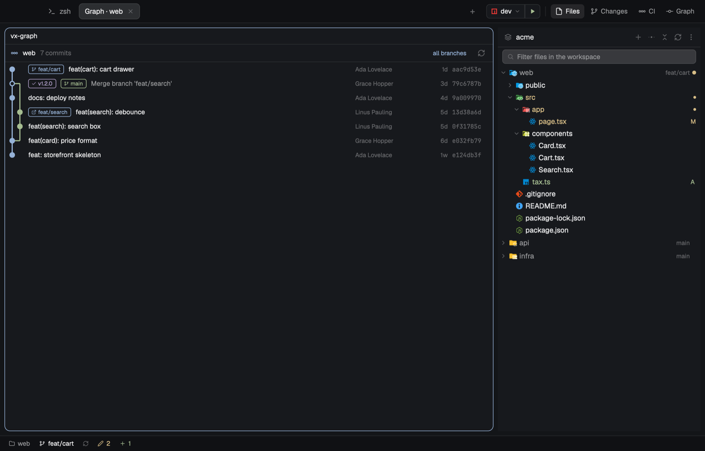

# herdr-vx

A VS Code-style workspace for [Herdr Desktop](https://herdr.dev): a multi-root Explorer, GitLens-style
git, GitLab and GitHub CI, a commit graph and a package-script runner, all following the repo you're
working in.



Herdr's own panels follow the focused terminal's folder, so a terminal sitting in a folder of several
repos shows nothing useful. herdr-vx reads your `*.code-workspace` (or a folder of repos) and keeps
one **active repo** that every panel follows: the one you pick, else the repo your terminal is in.

## What's in it

| Mod | Where | What |
|---|---|---|
| **vx-workspace** | Files panel | The Explorer: every root of the workspace with its file tree, git colours, ignored folders dimmed and a filter across all roots. Add / remove / rename / drag-reorder roots (written to the `.code-workspace` the way VS Code writes it); Open, Recent, New, Save As and Close workspace. |
| **vx-changes** | Changes panel | Staged / unstaged / conflicts, stage and unstage, commit and amend, plus GitLens-style Commits (expand for files), Branches, Remotes, Stashes, Tags, and Search & Compare. |
| **vx-ci** | CI panel (⌘⌥C) | GitLab pipelines (via `glab`) and GitHub Actions runs (via `gh`): runs, jobs by stage, retry, cancel, run a pipeline or dispatch a workflow, download artifacts. |
| **vx-graph** | centre tab | Commit Graph: branch lanes, branch and tag labels, commit details and their diffs. |
| **vx-files** | centre tab | File preview: syntax colours, Markdown, images, and GitLens blame with an age heatmap, file history and line history. |
| **vx-tabs** | tab bar | Tabs, `+`, the package-script runner, and Files · Changes · CI · Graph on the right. |
| **vx-scripts** | popup | Every `package.json` script (workspace packages too), run in a new tab or beside you, with npm / pnpm / yarn / bun detected and switchable. |
| **vx-status** | bottom bar | Repo, branch, ↑↓ with fetch / pull / push, changes; with the Claude Code plugin, the model and context / usage meters. |
| **vx-icons** | assets | [Material Icon Theme](https://github.com/material-extensions/vscode-material-icon-theme) icons (MIT) and the UI icons. |

Changes, CI and Graph each have a `repo ▾` switcher in their header.


## Install

Paste this into your agent inside Herdr:

```text
Read ~/.config/herdr-app/AGENTS.md, then add this layout: https://github.com/sardar099/herdr-vx
```

Or by hand, from a clone:

```sh
cp layouts/vx.json layouts/vx.svg ~/.config/herdr-app/layouts/
cp -R mods/vx-* ~/.config/herdr-app/mods/
herdr-app do layout.switch '{"name":"vx"}'
```

**Just one piece?** Each folder at the top of this repo is its own gallery entry with its own
recipe: `vx-workspace/` (Explorer + preview tab), `vx-changes/` (+ Commit Graph), `vx-ci/`,
`vx-tabs/` (+ script runner), `vx-status/`, and `vx-icons/` (the icon pack every vx mod needs).

Your own layout stays as it was; `ctrl-shift-l` (⌘⇧L on macOS) switches back. Optional key for CI
(add to `~/.config/herdr-app/keys.json`): `"cmd-alt-c": "mod.open:vx-ci"`.

The Claude Code plugin that fills the status bar's model and usage meters:

```sh
claude plugin marketplace add sardar099/herdr-vx
claude plugin install vx-status@vx
```

## Needs

- **git**. **glab** (logged in) for GitLab CI, **gh** (logged in) for GitHub CI. SSH host aliases in
  `~/.ssh/config` (e.g. `Host work-github`) are resolved to their real host.
- macOS is tested. Folder listings use `sh`, so Linux should work; Windows isn't supported.

## Safety

Reads use `git --no-optional-locks -c core.fsmonitor=false`, so nothing writes under `.git` behind
your back. Programs get argument lists, never shell strings built from file names or API data.
Anything that changes a repo or CI asks first: push, pull, fetch, retry, cancel, run pipeline,
dispatch, switch branch, apply stash. Stage and unstage touch only the index; commit is a button.
Nothing here deletes files or discards changes.

## Development

`shared/` holds the code every mod uses; `tools/build.mjs` copies it into each mod folder (a Herdr mod
can only import from its own folder, and people install a mod by copying it). `*-core.js` files are
pure and tested under node.

```sh
npm test       # node --test tests/
./sync.sh      # build, herdr-app check, install into ~/.config/herdr-app/mods (atomic; unchanged mods skipped)
```

How it's put together, for an agent rebuilding it: [RECIPE.md](RECIPE.md).

## Licence

MIT, see [LICENSE](LICENSE). The Material Icon Theme icons in `mods/vx-icons/icons/` are MIT,
copyright Material Extensions; their licence is in `mods/vx-icons/LICENSE-material-icon-theme.txt`.
