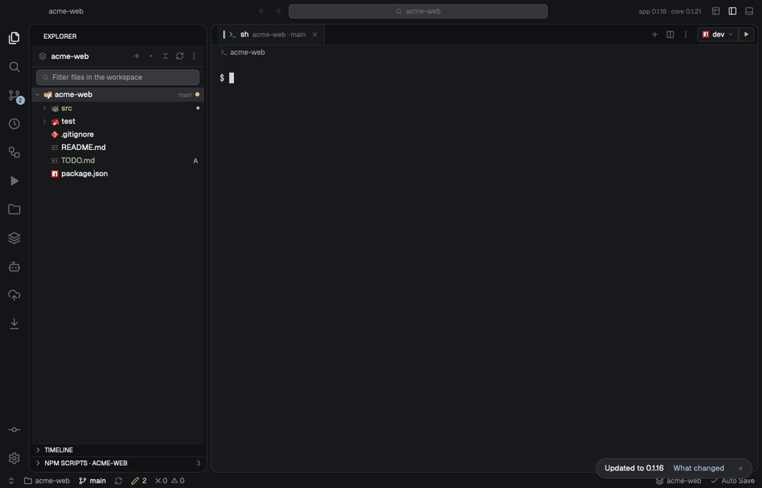
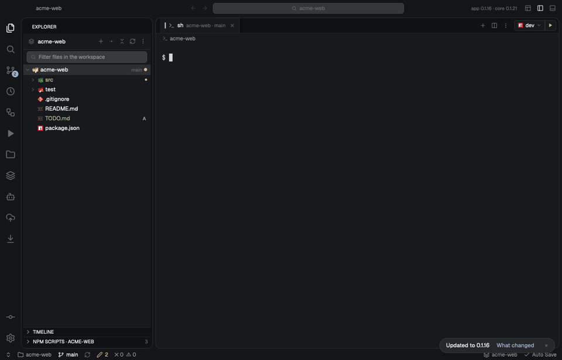
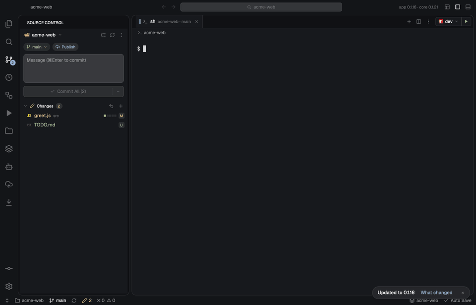
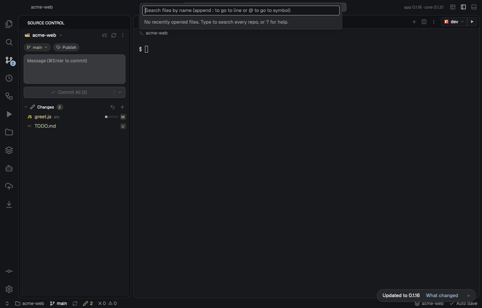
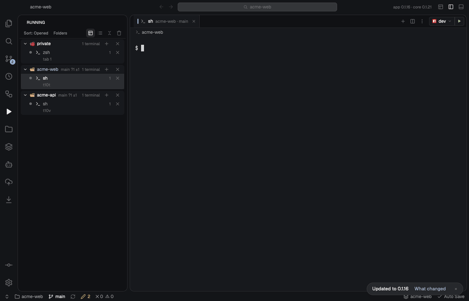

# herdr-vscode

**Turn [Herdr Desktop](https://herdr.dev) into a VS Code-style workspace for your terminals and agents.**



A multi-root Explorer, Search across every repo, GitLens-style git, GitLab and GitHub CI, a commit
graph, file preview and editing with auto save, a package-script runner, a Running view of every
terminal and agent, and a bottom panel with Problems, Terminal and Ports. Every panel follows one
**active repo**: the one you pick, else the repo your terminal is in.

Based on [herdr-vx](https://github.com/sardar099/herdr-vx) by sardar099 (MIT), with the AI features
removed, vscode-icons in place of Material icons, and many views added.

Two layouts:

- **`herdr-vscode`**: the whole window laid out like the current VS Code: title bar with a command
  center, activity bar, side bar, editor and bottom panel as rounded cards, and a status bar. Ships
  the **One Monokai** theme. See [herdr-vscode/RECIPE.md](herdr-vscode/RECIPE.md).
- **`herdr-vscode-classic`**: Herdr's own window with the herdr-vscode panels on the right. See
  [RECIPE.md](RECIPE.md).

## Features

### Explorer and Search

Every root of your `.code-workspace` (or a folder of repos) with its file tree, git colours and a
filter across all roots. Search runs `git grep` over every repo.



### Source Control and history

Stage, unstage and discard per file or per hunk; Commit, Commit & Push, Amend; pull, push, sync,
stash, branches, tags, and GitLens-style Commits with graph lanes.



### Quick Open and tab switcher

⌘P opens files of every repo (`:` line, `@` symbol, `>` commands, `%` text); ⌘E switches tabs in
recent order.



### Running, Projects and the bottom panel

Every terminal and agent grouped by repo with a git line per repo; your projects list; Problems,
Terminal and Ports below.



### CI

GitLab pipelines (`glab`) and GitHub Actions (`gh`): runs, jobs by stage, retry, cancel, run a
pipeline, dispatch a workflow, download artifacts. Every action asks first.


## What's in it

| Mod | Where | What |
|---|---|---|
| **herdr-vscode-workspace** | Explorer | The Explorer: every root of the workspace (vscode-icons root-folder icons, branch, status dot) with its file tree, git colours, ignored folders dimmed and a filter across all roots. Add / remove / rename / drag-reorder roots (written to the `.code-workspace` the way VS Code writes it); Open, Recent, New, Save As and Close workspace. |
| **herdr-vscode-changes** | Source Control | VS Code's Source Control: a commit box with Commit All, Commit & Push / Sync and Amend; staged / unstaged / merge changes with stage, unstage and discard per file (hover or right-click) and **per hunk** in the diff tab; pull, push, publish, sync, fetch, stash and new branch. Plus GitLens-style Commits (graph lanes, authors, branch and tag pills, incoming / outgoing), Branches (switch, delete), Remotes (check out), Stashes (apply, pop, drop), Tags, and Search & Compare. |
| **herdr-vscode-ci** | CI panel (⌘⌥C) | GitLab pipelines (via `glab`) and GitHub Actions runs (via `gh`): runs, jobs by stage, retry, cancel, run a pipeline or dispatch a workflow, download artifacts. |
| **herdr-vscode-graph** | centre tab | Commit Graph: branch lanes, branch and tag labels, commit details and their diffs. |
| **herdr-vscode-files** | centre tab | File preview: syntax colours, Markdown, images, GitLens blame with an age heatmap, file and line history, and **Edit** (Herdr's code editor, ⌘S saves). Also the Timeline side-bar section. |
| **herdr-vscode-tabs** | tab bar | Tabs with icons and repo context, italic preview tabs (double-click keeps one), pinned tabs, a right-click menu (Keep Open, Pin, Rename, Close Others / to the Right, Put Away), drag to reorder, all-tabs list and ⌘E switcher in recent order, a dot for unsaved edits, the package-script runner; in herdr-vscode also the breadcrumbs. |
| **herdr-vscode-scripts** | popup | Every `package.json` script (workspace packages too), run in a new tab or beside you, with npm / pnpm / yarn / bun detected and switchable. Also the NPM Scripts side-bar section. |
| **herdr-vscode-status** | bottom bar | Repo, branch, ↑↓ with fetch / pull / push, changes, conflicts, stashes; in herdr-vscode also `✕ errors ⚠ warnings` (opens Problems), the listening-port count (opens Ports) and the repo's last pipeline. |
| **herdr-vscode-search** | side bar (herdr-vscode) | Search across every repo of the workspace (`git grep`): Match Case, Whole Word, Regex, files to include; a match opens the file at its line. |
| **herdr-vscode-panel** | bottom panel (herdr-vscode) | Problems (conflicts, failing pipelines, branches behind, and **Run checks**: the repo's typecheck / lint scripts as file:line rows), Terminal (shells that never become tabs), Ports (listening programs: open, or stop after asking). |
| **herdr-vscode-running** | side bar (herdr-vscode) | Running: every terminal and agent grouped by its repo or folder, like herdr-folders: status (orch work shows as a magenta spinner), a git line per repo (`main ↑1 ?2 ±3`, `=` when clean), two-row or one-row items, card backgrounds; click to focus, right-click for Focus / New tab here / Show git changes / Close, close asks first. |
| **herdr-vscode-projects** | side bar (herdr-vscode) | Projects, like herdr-project-manager and its `projects.json` (globs, excludes, pinned projects): fuzzy filter, Enter or click opens a space, right-click for Open in new tab, Open repository, Copy path, Remove; the gear edits `projects.json` in herdr-vscode-files. |
| **herdr-vscode-updates** | side bar (herdr-vscode), an extension | Auto-update for the app and herdr-core, like herdr-auto-update and its `config.json`: versions, what's ready, release notes, toggles, Check now / Update core / Restart to update; restarts only when no agent is working. |
| **herdr-vscode-activity** | activity bar (herdr-vscode) | Explorer, Search, Source Control, CI, Running, Projects, Spaces, Agents with badges, then any [extension](docs/extensions.md) views; Graph and Settings. Also the side bar's title. |
| **herdr-vscode-titlebar** | title bar (herdr-vscode) | `app <ver> · core <ver>` at the top right (`↑ <ver>` when an update waits; click for Updates). Workspace name, ← → through visited tabs, the command center and **Quick Open** like VS Code's: files of every repo with the matched letters highlighted (recently opened first, `name:42` opens at a line), `:` go to line, `@` go to symbol, `>` every Herdr and herdr-vscode command with its key, `%` search text, `?` help; ⌘Enter opens to the side. Layout toggles. |
| **herdr-vscode-icons** | assets | [vscode-icons](https://github.com/vscode-icons/vscode-icons) icons (MIT, v13.0.0) and the UI icons. |

Changes, CI and Graph each have a `repo ▾` switcher in their header.

## Install

### With your agent

Ask the coding agent in a Herdr terminal:

> Add the herdr-vscode layout from https://github.com/barnuri/herdr-vscode

It follows Herdr's "Layouts and mods other people made" steps: reads [RECIPE.md](RECIPE.md), copies
`layouts/` and `mods/`, merges the keys, checks each mod and switches to the layout.

### With sync.sh

Needs Node 18+ and Herdr's `herdr-app` command (both only for installing).

```sh
git clone https://github.com/barnuri/herdr-vscode
cd herdr-vscode
./sync.sh --layout herdr-vscode           # every mod (checked first), the One Monokai theme, the layout
node tools/add-keys.mjs herdr-vscode      # the keys below; keys you already set win
herdr-app do layout.switch '{"name":"herdr-vscode"}'
```

`sync.sh` installs into `~/.config/herdr-app` (or `$HERDR_APP_HOME`). For the other layout:
`./sync.sh --layout herdr-vscode-classic`. An install from before the rename (`vx-*` mods, the
`vx-code` layout) is migrated by `./sync.sh`: it installs the new names with the old layout's clicks
and keys, shows the new layout if the old one was shown, and moves the old files to the Trash. Your own layout stays as it was: `ctrl-shift-l` (⌘⇧L on macOS) switches
between layouts.

**Just one piece?** Each folder at the top of this repo is its own gallery entry with its own
recipe: `herdr-vscode-workspace/` (Explorer + preview tab), `herdr-vscode-changes/` (+ Commit Graph), `herdr-vscode-ci/`,
`herdr-vscode-tabs/` (+ script runner), `herdr-vscode-status/`, `herdr-vscode-running/`, and `herdr-vscode-icons/` (the icon pack every herdr-vscode mod needs).
`herdr-vscode/` is the VS Code layout with every mod it uses.

### Theme

One Monokai is in Settings › Look once `themes/one-monokai.json` is in `~/.config/herdr-app/themes/`
(`sync.sh` puts it there), or set `"theme": "one-monokai"` in `settings.json`. herdr-vscode works with any
theme, light ones too.

### Keys (herdr-vscode)

| Key | Does |
|---|---|
| ⌘P | Quick Open: files; `:` line, `@` symbol, `>` commands, `%` text, `?` help |
| ⌘⇧O | Go to Symbol in the open file |
| ⌘⇧F | Search |
| ⌘⇧E / ⌘⇧G / ⌘⇧R | Explorer / Source Control / Running |
| ⌘J or `` ctrl-` `` | Show or hide the bottom panel |
| ⌘E | Switch tab (recent first) |
| ⌘\ | Split right |
| ⌘S | Save the file you're editing |
| ⌘W | Close the tab (the last one leaves an empty editor; an unsaved Untitled asks first) |
| ⌘B | Show or hide the side bar (Herdr's) |

They live in the `layout:herdr-vscode` section of `~/.config/herdr-app/keys.json`, so other layouts keep
Herdr's keys (⌘P stays Herdr's picker there). Optional, any layout: `"cmd-alt-c": "mod.open:herdr-vscode-ci"`
toggles CI.

## Settings

Your choices (activity bar order and hidden icons, Source Control view and diff layout, auto save,
blame, hidden files, search options, Git History branches, CI filters, panel tab, Pending Repos)
are saved in `~/.config/herdr-vscode/settings.json`, one section per feature. You can edit the file
by hand; the list of keys and defaults is in [CLAUDE.md](CLAUDE.md).

- **Auto save**: on by default (after a short delay), like VS Code. Turn it off or on from the tab
  right-click menu (Auto Save) or the status bar. Off, ⌘S saves.
- **Shared configs**: herdr-vscode reads the same files as the Herdr plugins, so one config drives
  both:
  - Running shares herdr-folders' `~/.local/state/herdr-folders/state.json` (view settings).
  - Projects reads herdr-project-manager's
    `~/.config/herdr/plugins/config/barnuri.project-manager/projects.json` (globs, excludes, pinned).
  - Updates reads herdr-auto-update's `~/.config/herdr/plugins/config/barnuri.auto-update/config.json`.
- **Pending Repos** (an extension view): `pending.root` (the folder to scan, default `~/code`) and
  `pending.auditScript` (default: the bundled `repo_pending_audit.py`) in `settings.json`. The
  `settings` in its installed `~/.config/herdr-app/mods/herdr-vscode-pending/mod.json` are still read
  as a fallback.
- **Logs**: every mod writes its actions (git actions, file operations, tab closes, updates) and
  errors to `~/Library/Logs/herdr-vscode/herdr-vscode.log`; errors also to `herdr-vscode-error.log`.

## Extensions

Any mod can add its own activity-bar view with a `herdr-vscode-extension.json` file (the older name
`vx-extension.json` still works). See [docs/extensions.md](docs/extensions.md) and
`examples/hello-extension/`. Pending Repos and Updates are built this way.

### Update and remove

Update: `git pull && ./sync.sh` (unchanged mods aren't touched; Herdr reloads the rest). Remove:
switch to another layout, then delete `layouts/herdr-vscode.json` and `.svg`, the `mods/herdr-vscode-*` folders,
`themes/one-monokai.json` and the `layout:herdr-vscode` section of `keys.json` in `~/.config/herdr-app/`.

## Needs

- **git**. **glab** (logged in) for GitLab CI, **gh** (logged in) for GitHub CI. SSH host aliases in
  `~/.ssh/config` (e.g. `Host work-github`) are resolved to their real host.
- Run checks uses your repo's own `typecheck` / `lint` scripts (and its package manager); Ports uses
  `lsof` (built into macOS).
- macOS is tested. Folder listings use `sh`, so Linux should work; Windows isn't supported.

## Safety

Reads use `git --no-optional-locks -c core.fsmonitor=false`, so nothing writes under `.git` behind
your back. Programs get argument lists, never shell strings built from file names or API data.
Anything that changes a repo or CI asks first and shows the commands it will run: push, pull,
sync, publish, fetch, retry, cancel, run pipeline, dispatch, switch or delete branch (`branch -d`,
which refuses unmerged work), apply / pop / drop stash, and **discard**. Discard puts edited files
back to their last staged or committed copy and moves new files to the macOS Trash (staged changes
stay). Stage and unstage (also per hunk) touch only the index; commit is a button; new branch and
stash are dialogs you fill in. Nothing is sent to an AI service.

What herdr-vscode adds: **Edit** writes the file you're editing only when you press Save (⌘S), and
refuses if the file changed on disk since you opened it. **Run checks** runs the repo's own
`typecheck` / `lint` scripts from `package.json` when you click it. **Ports** lists listening
programs with `lsof`; Stop sends SIGTERM and asks first. Search is read-only (`git grep`).

## Development

`shared/` holds the code every mod uses; `tools/build.mjs` copies it into each mod folder (a Herdr mod
can only import from its own folder, and people install a mod by copying it). `*-core.js` files are
pure and tested under node.

```sh
npm test       # node --test tests/
./sync.sh      # build, herdr-app check, install mods + themes + our installed layouts (atomic; unchanged skipped)
node tools/add-keys.mjs herdr-vscode   # merge a layout card's keys
```

How it's put together, for an agent rebuilding it: [RECIPE.md](RECIPE.md). The demo GIFs are
recorded from fake repos by [skills/herdr-vscode-demo](skills/herdr-vscode-demo/SKILL.md).

## Credits and licences

MIT, see [LICENSE](LICENSE). Based on [herdr-vx](https://github.com/sardar099/herdr-vx) (MIT). The
vscode-icons icons in `mods/herdr-vscode-icons/icons/` are MIT; their licence is in
`mods/herdr-vscode-icons/LICENSE-vscode-icons.txt`. To rebuild them from a vscode-icons release:
`node tools/build-icons.mjs <unpacked .vsix extension folder> <vscode-icons src/iconsManifest/languages.ts>`
(it skips SVGs with active content and refuses a non-empty `icons/` folder).
