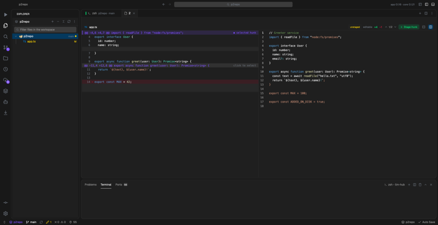

# Editable split diff (Source Control)

Goal: like VS Code's diff editor, the right side (working tree) of a split diff is editable.

## What gpui-kit allows

The only multi-line code editor is `EditorState` + `Editor` (gpui-kit.d.ts). Its API is `value`,
`set_value`, `selected_range`, `set_selected_range`, `replace`, `focus` and the events `change`,
`blur`, `focus`. It has no scroll position (get or set), no line decorations or backgrounds, and no
read-only spacer lines.

So the planned design (right side = editor aligned with the left rows by spacer lines) is not
possible: spacer lines would have to be real text in the buffer and would be saved into the file.
The fallback (sync scroll + changed-line highlight) is not possible either: there is no scroll API
and no line decoration.

## What we do

Split layout, working-tree diffs only (`unstaged` scope or an untracked file, local repo):

- Left: the HEAD/index side of the diff rows, read-only, in the same virtual list as before
  (removed lines red, blank rows where the right side only adds lines, hunk headers).
- Right: the full working file in the same editor as `herdr-vscode-files` (always editable, same
  font, syntax colors, `editor.wordWrap`). `files.autoSave` (`afterDelay` / `off`) and ⌘S save it
  with `writeTextFile` against the last saved text.
- After each save the diff reloads (`git diff`), so the left side and the hunk list follow.
- Line mapping: Previous/Next hunk scrolls the left list to the hunk and puts the editor cursor on
  the hunk's first new line (`set_selected_range`); the editor scrolls to its cursor.
- A file changed on disk while the buffer is clean is reloaded into the editor.

Inline mode, staged, commit, stash and compare diffs stay read-only, as before.

If gpui-kit later gets scroll offsets or line decorations, add sync scroll and green line marks on
the right side.

