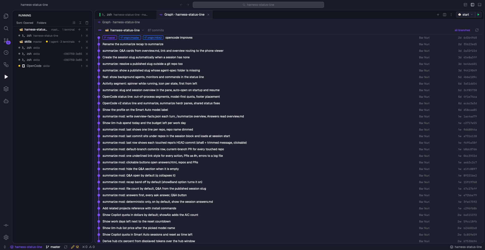

# herdr-vscode-projects

A Projects view for Herdr, like the herdr-project-manager plugin (and VS Code's Project Manager): your projects, found by glob or pinned by hand, one click from a space.

## What you see

A filter box, then one row per project: its vscode-icons folder icon (open when a space works there), its name, a status dot when it's open (the space's agent status colour, green when idle; a dim dot when only a terminal works there), and a `+` button. A footer counts the shown and total projects.

## How it behaves

Type to filter (fuzzy, best match first); `↑`/`↓` move, Enter opens. Click a project to open it as a space: the space whose folder is the project, else a new space named after it. Right-click it, or `+`, to open it as a new tab in the current space. Toolbar: `+` pins the focused folder as a project, the gear opens `projects.json` in `$EDITOR` in a new tab, refresh discovers again (also every minute).

## Built from

`mods/herdr-vscode-projects` (`main.js`, `projects-core.js`). It reads the same files as herdr-project-manager: `~/.config/herdr/plugins/config/barnuri.project-manager/projects.json` (herdr passes this folder to the plugin as its config dir) (`globs`, `excludes`, `projects: [{ name, path }]`) and the cache `~/.local/state/herdr-project-manager/projects-cache.json`, which paints the list at once and is rewritten after each discovery. Globs expand with zsh (`**` recursive); a match on `.git` registers its parent folder; excludes beat globs, and a plain path excludes its whole tree; same-named projects get their parent path in brackets. In the herdr-vscode layout it is the `projects` child of the `sidebar-views` stack (folder icon in the activity bar). Uses `spaces()`, `panes()`, `run("space.new" | "space.select" | "tab.new")`.

## Watch out

Needs `herdr-vscode-icons` next to it, and `zsh` for discovery. Projects are on this computer; spaces on another machine never count as open.

## Done when

The cached list shows at once; a new glob in `projects.json` shows its repos after a refresh; Enter on a project already open as a space shows that space instead of a second one.
