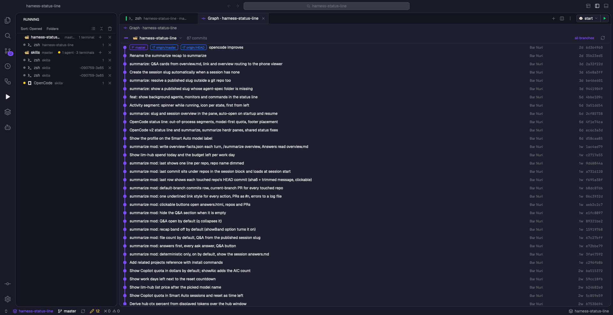

# herdr-vscode-running

A Running view for Herdr: every terminal and agent, grouped by the folder it works in (its git repo root, or its folder), like the herdr-folders sidebar.

## What you see

One row per folder: chevron, the folder's vscode-icons icon, its name (accent when the focused pane is in it), its branch, a status dot for the most urgent agent (blocked > working > done > idle), the count of agents and terminals, and `+` (new terminal there) and `×` (close all, asks first) buttons.

Under it, one row per pane: a status dot (`working`, `blocked`, `done`, `idle` theme colours; `dim` for a plain shell), the program icon, the program name, the terminal title (or the folder name), and the tab name. The focused pane has the `selected` background.

## How it behaves

Click a folder to fold or unfold it (remembered per copy). Click a pane to show its space and tab and focus it. Right-click a pane to close it, after a confirm dialog. The list follows Herdr's live data. Repo roots are looked up once per folder with `git rev-parse` and rechecked every 2 s for new folders.

## Built from

`mods/herdr-vscode-running` (`main.js`, `running-core.js`). In the herdr-vscode layout it is the `running` child of the `sidebar-views` stack, opened from the activity bar (play icon, `⌘⇧R`). Uses `panes()`, `spaces()`, `run("space.select" | "tab.select" | "pane.focus" | "tab.new")`, and runs `git` and `herdr-app do pane.close`.

## Watch out

Needs `herdr-vscode-icons` next to it. Mod panes are left out. Folders on another machine resolve their repo root on that machine.

## Done when

Every open terminal shows once, under its repo; an agent's dot changes colour with its status; clicking a row focuses that pane; closing asks first.
