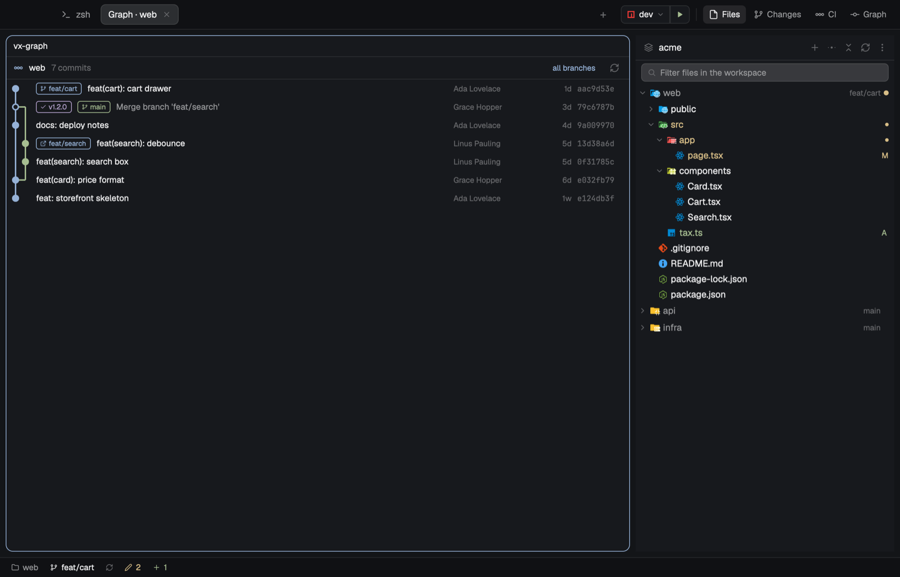

# herdr-vscode-status

A bottom bar for Herdr: the repo and branch you're working in, ahead / behind with fetch, pull and push (each confirmed), and changed / staged / conflicts / stashes.

## What you see

`props { style: "vscode" }` (the herdr-vscode layout): `canvas`, no border, 12px text and 14px icons, a remote glyph first, `✕ errors ⚠ warnings` (opens Problems) and the listening-port count (opens Ports) after the repo chips, and on the right the repo's last pipeline (CI icon in its state colour + `passed` / `failed` / …) and the workspace name.

Default: 28px, `chrome`, a top border: folder (an accent layers icon when it's the repo you picked rather than the terminal's), branch (click copies), ↑↓ (menu: Push…, Pull… `--ff-only`, Fetch…), ✎ changed `ansi3`, + staged `ansi2`, ⚠ conflicts `ansi1`, ▣ stashes `dim`, `clean`.

## How it behaves

Follows the active repo (herdr-vscode-workspace) or the focused terminal; rereads on change and every 8 s. Fetch / pull / push run only after their confirm dialog. Changed and conflicts open the Changes panel.

## Built from

`mods/herdr-vscode-status`. Block: `{ "id": "status", "type": "block", "size": { "px": 28 }, "content": { "mod": "herdr-vscode-status" } }`. Runs `git`, `mkdir` (the state folder).

**Install:** copy `mods/*` from this folder into `~/.config/herdr-app/mods/`, and also copy
`herdr-vscode-icons/mods/herdr-vscode-icons` from this repo (every herdr-vscode mod draws its icons from it). Then put the
block in a layout you own (below). The whole set as a ready layout: the repo root (`layouts/herdr-vscode-classic.json`).

## Watch out

Every herdr-vscode mod needs `herdr-vscode-icons` next to it (icons go blank without it). The mods share state through Herdr's `shared()` keys `herdr-vscode.*`, so they work alone but follow each other when installed together. Only one copy of each panel mod per layout.

## Done when

- In a repo the bar shows branch, ↑↓ and change counts.
- Push asks first.
- `herdr-app check` passes for every mod in this folder.
