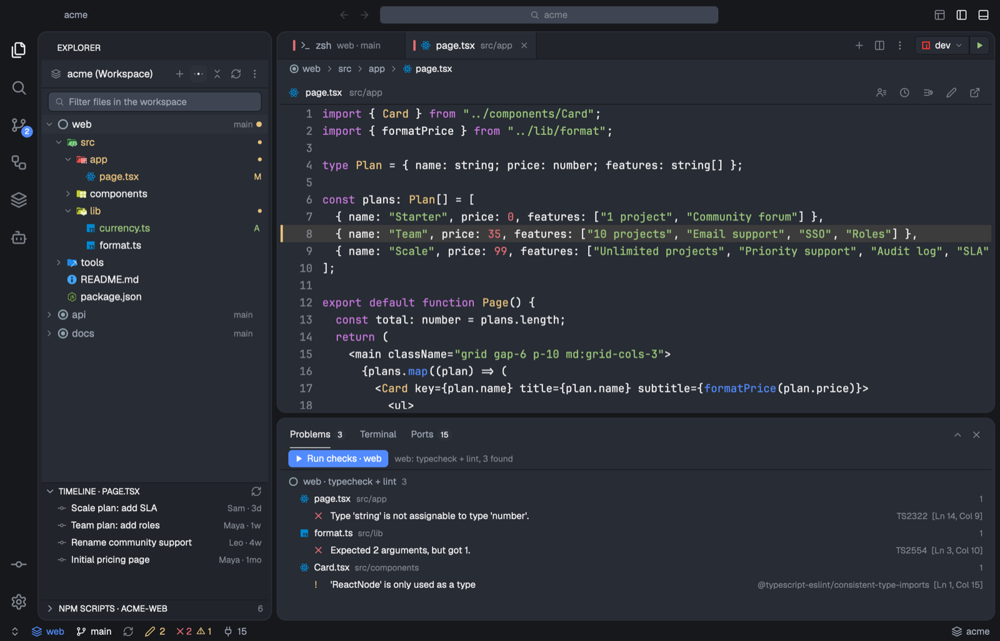

# herdr-vscode

Herdr laid out like the current VS Code: a title bar with a command center, an activity bar, and three rounded cards (side bar, editor, bottom panel) on a dark canvas, with a plain status bar. The side bar holds a multi-root Explorer of your `.code-workspace`, Search, GitLens-style Source Control, CI, Running, Spaces and Agents; the editor shows terminals, agents, file previews you can edit, diffs and a commit graph. Ships the One Monokai theme.

## What you see

Top to bottom, on the theme's `canvas`:

- **Title bar** (`titlebar`, 38px, `window_drag`, herdr-vscode-titlebar): room for the traffic lights, the workspace name in `muted`; centred ← → (26px, 40% opacity when there's nowhere to go) and the **command center** (24px, up to 520px, radius 6, `border`, search icon + workspace name); on the right Customize Layout, Toggle Side Bar, Toggle Panel (15px icons, `dim`, `foreground` when on).
- **Body** (row, 2px top and bottom padding):
  - **Activity bar** (48px, `canvas`): 22px icons in 48px cells: Explorer, Search, Source Control, CI / CD, Running, Spaces, Agents; at the bottom Commit Graph and Settings. The shown view is `foreground`, others `dim`. Badges: a 15px `accent` pill with the number of changed files on Source Control, agents waiting on Agents; an 8px dot on CI (`ansi1` a failed pipeline, `ansi4` running).
  - **Side bar card** (300px, 200–640, radius 12, 1px `raised` border, `chrome`, 4px padding): a 32px title (`EXPLORER`, `SEARCH`, `SOURCE CONTROL`, `CI / CD`, `RUNNING`, …, 11px medium) over a stack of the views. Explorer = the workspace tree (header `name (Workspace)` + buttons, a filter, one row per root with the vscode-icons root-folder icon, its branch, a status dot) above two collapsible sections, **Timeline · file** and **NPM Scripts · package** (22px headers, chevron, uppercase).
  - **Work column** (6px side padding, 6px gap):
    - **Editor card** (radius 12, `raised` border, `background`): the **tab bar** (35px, `chrome`, rounded top, a 10px inset strip): flush tabs with 1px separators: a 3px repo-colour mark, the program or file icon, the name (italic while it's the reused preview), a faint context (`repo · branch` or the file's folder), and × on hover / on the active tab (a dot when the file has unsaved edits; a spinner or status dot for agents). Active tab: `background`; others `chrome`. Right: `+`, Split Right, ⋯ (all tabs) and the package-script control. Under it the **breadcrumbs** (24px, `background`): root ring › folders › file icon + name. Then the active tab's panes, inset 4px.
    - **Bottom panel card** (260px, hidden at first, same card look, 4px padding): a 34px header with tabs **Problems** (count pill), **Terminal**, **Ports** (count), the active one underlined in `foreground`; on Terminal also `shell - folder`, +, 🗑; then ⌃ maximise and ×. Under it the chosen tab.
- **Status bar** (24px, `canvas`): a remote glyph, the repo, branch, sync, changes, staged, conflicts, `✕ errors ⚠ warnings`, the port count; right: the repo's last pipeline (CI icon in its state colour + `passed` / `failed` / `running` / `manual`), the workspace name. 12px text, 14px icons.

## How it behaves

- **Activity bar**: clicking a view shows it in the side bar; clicking the shown one hides the side bar. Graph opens the Commit Graph tab of the active repo; Settings opens Herdr's settings.
- **Active repo**: every view follows the repo you picked (Explorer click, a `repo ▾` switcher) or else the repo of the focused terminal.
- **Quick Open** (⌘P or the command center): a popup over the command center (up to 720px wide, sized to its rows, 24px rows, 18 shown). Input: VS Code's placeholder, `accent` border, no icon. Rows: 16px icon, name in `foreground` with matched letters `accent` and semibold, then `repo • folder` in `dim`; the first row of a group carries its label on the right (`recently opened`, `file results`, `recently used`, `other commands`, `symbols (n)`) and a top border; the selected row (`selected`) shows Open to the Side and, for a recent file, × Remove from Recently Opened. Modes: files of every root (`git ls-files`, words must all match, name hits first; `name:42` opens at line 42), `:` line in the active file, `@` symbols of it (classes, functions, methods, types, consts, headings; ⌘⇧O), `>` Herdr's commands (`commands()`, those needing no arguments, plus bound actions like `pane.split:right`) and herdr-vscode's own, with their key from `keys()`, recently used first, `%` text across every root (`git grep`), `?` the list of prefixes. ↑↓ wrap, PageUp / PageDown, Enter, ⌘Enter to the side, Esc. Every file previewed anywhere joins "recently opened" (`herdr-vscode.goto.recent`).
- **Running** (⌘⇧R): every terminal and agent grouped by repo or folder; a click focuses the pane. See [herdr-vscode-running/RECIPE.md](../herdr-vscode-running/RECIPE.md).
- **Search** (⌘⇧F): `git grep --untracked` in each root (respects `.gitignore`, skips binaries); Aa / ab / .* toggles (regex is Perl-compatible), ⋯ for "files to include" (`*.ts, src/`); results by repo › file › line with the match highlighted, capped at 2,000; a match opens the preview at that line.
- **Tabs**: the file and diff tabs are reused previews (italic); double-click or Keep Open makes one stay, and the next file opens a new preview; editing keeps it too. Drag to reorder, right-click for Keep Open, Pin / Unpin (pinned tabs are icon-only, on the left), Rename, Close, Close Others / to the Right (click twice), Put Away; every close goes through the same path as ⌘W (the last tab of a space leaves an empty editor, an unsaved Untitled asks) and is logged. ⋯ lists every tab with a filter; ⌘E is the same list in recent order with the previous tab preselected. Wheel or swipe switches tabs.
- **Preview**: syntax colours, changed-line bars, blame with heatmap, file / line history; ✎ switches to Herdr's code editor; ⌘S (or Save) writes the file only if it didn't change on disk since; Revert drops the edits.
- **Timeline**: the commits of the file in the active tab; a click opens that commit's diff. **NPM Scripts**: every script of the active repo's `package.json`; a click or ▶ runs it in a new tab.
- **Bottom panel** (⌘J, `` ctrl-` ``): Terminal starts a shell in the active repo the first time (`hc run`, label `herdr-vscode.panel=1`, never a tab), keeps it across hide / show, hides when the last one exits. Problems lists conflicts, failing pipelines, branches behind and unreadable repos (a click opens that view) and, after **Run checks**, the output of the repo's `typecheck` and `lint` scripts parsed into file:line rows (tsc, ESLint and `file:line:col:` formats); a click opens the file at the line. Ports lists `lsof` listeners with their folder; 🌐 opens `http://localhost:port`, ■ stops the process after asking.
- **Status bar**: ✕ ⚠ opens Problems, the port count opens Ports, the pipeline opens CI / CD, the branch copies itself, ↑↓ offers fetch / pull / push (asks first).
- **Keys** (`keys.json` section `layout:herdr-vscode`): ⌘P, ⌘⇧O, ⌘⇧F, ⌘⇧E, ⌘⇧G, ⌘⇧R, ⌘J / `` ctrl-` ``, ⌘E, ⌘\ split right, ⌘S save, ⌘W close tab (`herdr-vscode-tabs.close`); ⌘B toggles the side bar (Herdr's).

## Built from

- `layouts/herdr-vscode.json`: root `column` (`background: canvas`, `titlebar: none`, `traffic_lights: [12, 12]`): `titlebar` block (herdr-vscode-titlebar) · `body` row (`padding: [2, 0]`): `activity` (herdr-vscode-activity) · `sidebar` column (`radius 12`, `border raised`, `padding 4`): `sidebar-title` (herdr-vscode-activity `{title: true}`) and stack `sidebar-views`: `explorer` column [`explorer-tree` herdr-vscode-workspace, `timeline` herdr-vscode-files `{section: "timeline", block: "timeline"}`, `npm` herdr-vscode-scripts `{section: "npm", block: "npm"}`], `search` herdr-vscode-search, `scm` herdr-vscode-changes, `ci` herdr-vscode-ci `{panel: true}`, `running` herdr-vscode-running, `spaces` and `agents` (Herdr's) · `work` column (`padding [0, 6]`, `gap 6`): `editor` column (card) [`tabs` herdr-vscode-tabs `{style: "vscode"}`, `breadcrumbs` herdr-vscode-tabs `{breadcrumbs: true}`, `editor-body` (`padding [4, 4]`) → `main` `{tab: "active"}` with flat pane frames], `bottom` column (card, hidden) [`panel-head` herdr-vscode-panel, `term` herdr-vscode-panel `{empty: true}`] · `status` block (herdr-vscode-status `{style: "vscode"}`).
- Mods: herdr-vscode-titlebar, herdr-vscode-activity, herdr-vscode-workspace, herdr-vscode-files (preview, Timeline), herdr-vscode-search, herdr-vscode-changes, herdr-vscode-graph (opened as a tab), herdr-vscode-ci, herdr-vscode-running, herdr-vscode-tabs, herdr-vscode-scripts, herdr-vscode-panel, herdr-vscode-status, herdr-vscode-icons (icons for all). Each carries a copy of `shared/`.
- The bottom panel swaps what `term` shows with `layout.set` (the current `layout()` tree with that block's `content` replaced): `{terminal: "t7"}` for a shell, `{mod: "herdr-vscode-panel", props: {view: "problems" | "ports"}}`.
- Shared state: `herdr-vscode.workspace`, `herdr-vscode.active`, `herdr-vscode.git`, `herdr-vscode.ci.summary`, `herdr-vscode.panel` `{view, shown, list}`, `herdr-vscode.checks` (per repo), `herdr-vscode.ports`, `herdr-vscode.tabs.kept` / `.pinned` / `.mru`, `herdr-vscode.dirty`, `herdr-vscode-files.view` (per space, `{root, rel, line?}`), `herdr-vscode.goto.recent`.
- Programs: `git` (status, ls-files, grep, log, blame, diff), `glab` / `gh` for CI, `lsof`, `hc run`, the package manager for scripts and checks, `open`.
- `themes/one-monokai.json`: One Monokai (background `#282c34`, chrome `#21252b`, canvas `#16181c`, border `#181a1f`, raised `#2c313a`, accent `#528bff`, ANSI from the VS Code theme).

## Watch out

- Herdr doesn't clip anything inside a rounded node: blocks paint square corners over the curve. Pad the side bar and panel cards by 4px (their contents share the card colour), round the tab bar's top and inset its tabs 10px, and wrap the terminal block in a 4px-padded column.
- Draw the card border in `raised`, not `border`: in One Monokai `border` is darker than the canvas and the edge disappears.
- Mods hidden in a stack or a hidden column may not get key commands: route ⌘J through herdr-vscode-activity (always shown), and let the panel header start a shell when it appears.
- Name shared files so they can't collide with a mod's own (`tools/build.mjs` refuses).
- A virtual list's rows can't carry handlers (click, hover, tooltip): they draw nothing. Use the list's `on_item_click(key)`, or draw a small window of rows yourself (Quick Open draws its 18 visible rows and scrolls them on the wheel).
- Elements are single-use: cache row *data*, never elements (an icon kept in a cached row fails the next render with "element was already added to a parent").
- Keep heavy work out of render: Quick Open ranks ~15,000 paths only when the query changes, in slices of 2,500 between frames, with lowercased paths prepared once; a render that runs too long shows "This view could not be re-rendered … interrupted".
- `git grep -E` doesn't know `\w`: use `-P`, falling back to `-E` when git has no PCRE.
- Each layout edit by herdr-vscode-panel rewrites the installed layout file, so `sync.sh` only reinstalls the layout when the source changed.

## Done when

- Clicking Explorer / Search / Source Control / CI / Running swaps the side bar; clicking the shown one hides it.
- ⌘P lists files of every root; Enter opens the preview; `>` opens the palette.
- Searching a word lists matches by repo and file; a match opens the file scrolled to that line.
- Clicking a file in the Explorer opens an italic preview tab; double-clicking it keeps it and the next file opens a second tab.
- ✎ then typing shows the tab's dot; ⌘S saves and the dot goes.
- ⌘J shows a shell in the active repo that isn't listed as a tab; Run checks in a repo with a `typecheck` script lists its errors with Ln / Col.
- All three cards show rounded corners at all four edges in One Monokai and in a light theme.
