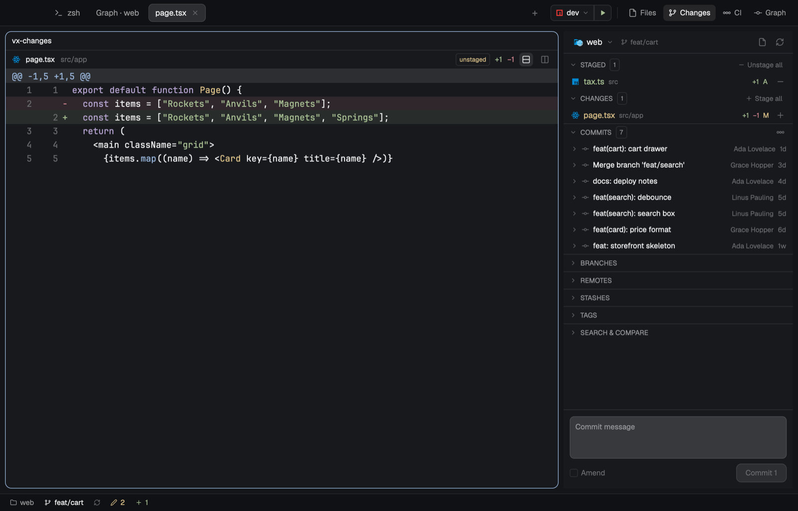

# vx-changes

GitLens-style git for Herdr's Changes panel: staged and unstaged changes, stage / commit / amend, and Commits, Branches, Remotes, Stashes, Tags and Search & Compare, with diffs in a centre tab and a Commit Graph.

## What you see

- **Header**: `[repo ▾]` switcher (the workspace's repos, branch, ✓ on the current one), ⑂ branch, flat/tree, refresh.
- **Conflicts / Staged / Changes** groups: icon, name, folder in `dim`, `+n −n`, letter, a 20px + / − button; Stage all / Unstage all.
- **Sections** (collapsible): Commits (expand one for its files; a button opens the Commit Graph), Branches (ahead/behind, upstream, compare, switch…), Remotes, Stashes (files, apply…), Tags, Search & Compare (search by message, author, file or hash; compare HEAD with its base or any branch / tag).
- **Commit box**: 68px message, Amend checkbox, `Commit N`.
- **Diff tab**: one per space, inline or side by side, syntax-coloured, `+`/`−` tinted `ansi2`/`ansi1`; for working files, a commit (vs first parent), a stash or a compare.
- **Commit Graph tab** (vx-graph): lanes per branch, merge commits hollow, branch / tag / remote labels, author, age, hash; click a commit for its message and files.

## How it behaves

Stage and unstage touch only the index (`add`, `reset -q HEAD`, `rm --cached` before the first commit); conflicts are never staged by Stage all. Commit takes only what's staged; Amend loads the last message and refuses if HEAD moved. Switch branch and Apply stash ask first. Nothing discards changes.

## Built from

`mods/vx-changes` (panel.js, sections.js, diff.js) and `mods/vx-graph`. Block: `{ "id": "changes", "type": "block", "content": { "mod": "vx-changes" } }`. Runs `git` only.

**Install:** copy `mods/*` from this folder into `~/.config/herdr-app/mods/`, and also copy
`vx-icons/mods/vx-icons` from this repo (every vx mod draws its icons from it). Then put the
block in a layout you own (below). The whole set as a ready layout: the repo root (`layouts/vx.json`).

## Watch out

Every vx mod needs `vx-icons` next to it (icons go blank without it). The mods share state through Herdr's `shared()` keys `vx.*`, so they work alone but follow each other when installed together. Only one copy of each panel mod per layout.

## Done when

- Staging a file moves it to Staged; Commit commits only it.
- A commit in Commits expands to its files and each opens its diff.
- The Commit Graph draws a merged branch as a second lane joining back.
- `herdr-app check` passes for every mod in this folder.
