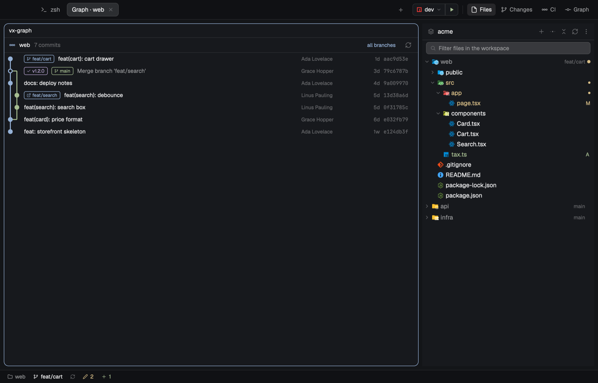

# vx-ci

GitLab pipelines and GitHub Actions in one Herdr panel, for the repo you're working in: runs with filters, jobs by stage, retry, cancel, run a pipeline or dispatch a workflow, download artifacts. Every action asks first.

## What you see

- **Header**: `[repo ▾]`, a GitLab or GitHub badge, ▶ (Run pipeline / Dispatch), open in browser, refresh.
- **Runs**: chips All / Running / Failed / Passed with counts and a branch toggle; two-line rows: status glyph (✓ `ansi2`, ✕ `ansi1`, ● `ansi4`, ○ `dim`, ▸ `ansi5`), commit subject, `#n · ref · trigger · age`.
- **A run**: status, subject, ref, sha, author, duration; Retry… / Cancel…; jobs grouped by stage with duration, retry / play / artifacts / log buttons.
- **Run pipeline** (GitLab): branch plus the `.gitlab-ci.yml` variables that have a description, and extra `KEY=value`. **Dispatch** (GitHub): branch, workflow, inputs.

## How it behaves

The project comes from `git remote get-url origin` (SSH host aliases resolved with `ssh -G`), then `glab api` or `gh api` with your active login. Running runs refresh every 5 s. Retry, cancel, job retry / play, run, dispatch and downloads (to `~/Downloads/vx-ci/<repo>/<run>/`) all go through a confirm dialog. `mod.open:vx-ci` toggles the panel (bind it to a key). Once a minute it publishes the latest run per workspace root (`vx.ci.summary`) for vx-workspace's dots.

## Built from

`mods/vx-ci` (main.js, providers.js). Block (in the `panel-body` stack): `{ "id": "ci", "type": "block", "content": { "mod": "vx-ci", "props": { "panel": true } } }`. Needs `glab` and/or `gh` logged in. Network goes only through those CLIs.

**Install:** copy `mods/*` from this folder into `~/.config/herdr-app/mods/`, and also copy
`vx-icons/mods/vx-icons` from this repo (every vx mod draws its icons from it). Then put the
block in a layout you own (below). The whole set as a ready layout: the repo root (`layouts/vx.json`).

## Watch out

Every vx mod needs `vx-icons` next to it (icons go blank without it). The mods share state through Herdr's `shared()` keys `vx.*`, so they work alone but follow each other when installed together. Only one copy of each panel mod per layout.

## Done when

- A GitLab repo lists its pipelines; a GitHub repo its Actions runs.
- A run opens its jobs by stage; Retry asks first.
- Run pipeline offers the described `.gitlab-ci.yml` variables.
- `herdr-app check` passes for every mod in this folder.
