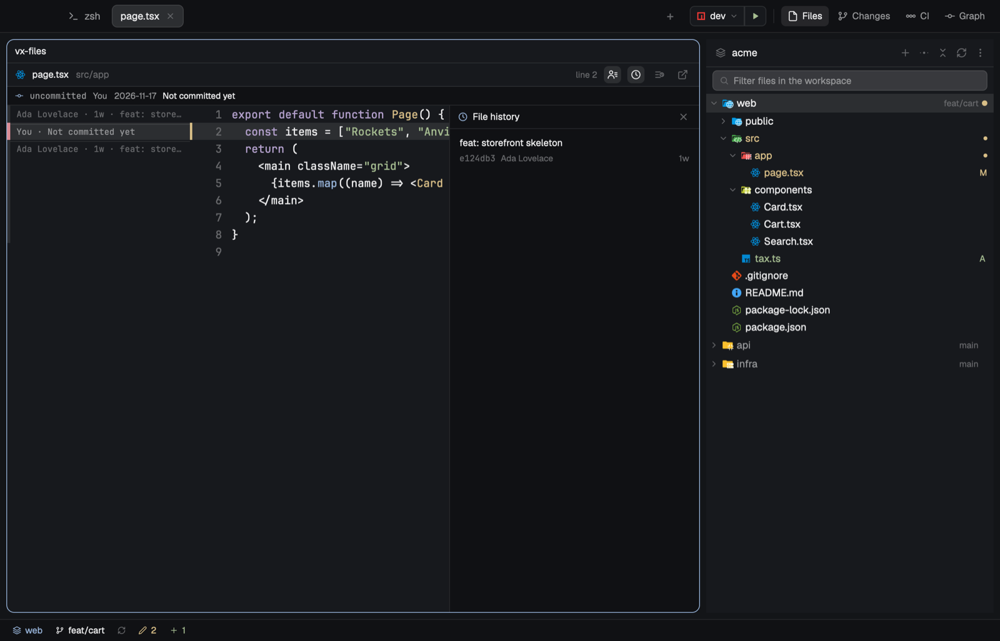

# vx-icons

The icon pack every vx mod draws from: the Material Icon Theme's file and folder icons (VS Code's picks by name, extension and path, light-theme variants, open folders) and the vx UI icons.

## What you see

Nothing on its own. Shown in a layout anyway, it lists a few sample names with their icons.

## How it behaves

Other mods read `mods/vx-icons/icons.json` (name / extension / folder tables) and draw `mods/vx-icons/icons/<id>.svg` with `image()`, and `mods/vx-icons/ui/<name>.svg` with `svg()` (tinted by the theme). The lookup: a path rule beats a name, a name beats an extension, the longest extension wins; light themes use the light table first.

## Built from

`mods/vx-icons`: `icons/` (1,184 SVGs from Material Icon Theme, MIT, licence in `LICENSE-material-icon-theme.txt`), `icons.json`, `ui/` (36 UI icons), a sample `main.js`. Install: copy `mods/vx-icons` into `~/.config/herdr-app/mods/`. The folder name must stay `vx-icons`.

## Watch out

Keep the folder name `vx-icons`: the other mods read it by path. A symlinked mod folder loads code but not images, so copy it.

## Done when

- `package.json` gets the Node icon, `src` the src folder icon, open folders their open icon.
- Every vx mod's buttons show their UI icons.
- `herdr-app check` passes for every mod in this folder.
