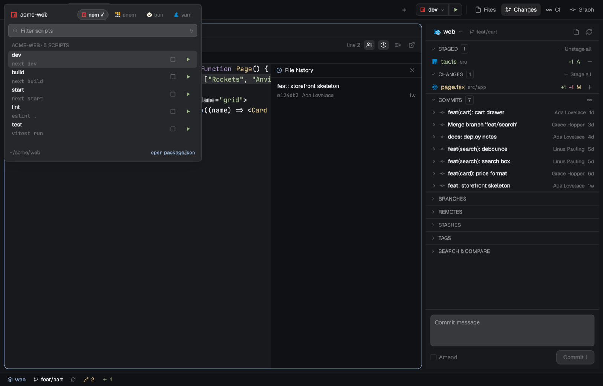

# vx-tabs

A tab bar for Herdr with the package-script runner built in and Files · Changes · CI · Graph on the right. Scripts come from `package.json` (workspace packages too) with npm / pnpm / yarn / bun detected and switchable.

## What you see

Tab pills as in Herdr (agent icon, spinner, status dot, ×), `+`, then `[pm logo] script ▾ │ ▶`, a divider, and Files · Changes · CI · Graph right-aligned (the open panel highlighted). ▾ opens the script list (vx-scripts): project name, the installed package managers (the detected one ✓), a filter, Recent, every script with its command, ⧉ run beside and ▶ run in a new tab.

Each tab also has its icon (program, or the file's vscode-icons icon), a faint context (`repo · branch`, or the file's folder) and a 3px repo-colour mark; preview tabs are italic; pinned tabs are icon-only on the left. ⌄ lists every tab. `props { style: "vscode" }` draws VS Code's flush tabs plus Split Right and ⋯; `props { breadcrumbs: true }` is the breadcrumb strip (root › folders › file).

## How it behaves

Double-click a preview tab to keep it (the next file opens a new preview); right-click for Keep Open, Pin / Unpin, Rename…, Close, Close Others / to the Right (click twice), Put Away. `vx-tabs.switch` (⌘E in vx-code) lists tabs in recent order with the previous one preselected. Double-click any other tab to rename, drag to reorder, wheel to switch; each space remembers its open panel. Scripts follow the active repo (vx-workspace) or the focused folder, looking up to 6 folders for `package.json`; the package manager comes from `packageManager`, else the lockfile, else npm, and the list's choice is kept per project. ▶ runs `<pm> run <script>` in a new tab in the package's folder. Graph opens the Commit Graph (vx-graph) of the active repo. `mod.open:vx-scripts` opens the list.

## Built from

`mods/vx-tabs` and `mods/vx-scripts`. Block: `{ "id": "tabs", "type": "block", "size": { "px": 42 }, "window_drag": true, "content": { "mod": "vx-tabs" } }`. Panel buttons appear for `files`, `changes`, `ci` children of a `panel-body` stack in a `panel` column.

**Install:** copy `mods/*` from this folder into `~/.config/herdr-app/mods/`, and also copy
`vx-icons/mods/vx-icons` from this repo (every vx mod draws its icons from it). Then put the
block in a layout you own (below). The whole set as a ready layout: the repo root (`layouts/vx.json`).

## Watch out

Every vx mod needs `vx-icons` next to it (icons go blank without it). The mods share state through Herdr's `shared()` keys `vx.*`, so they work alone but follow each other when installed together. Only one copy of each panel mod per layout.

## Done when

- In a JS project the control shows the detected package manager and `dev`.
- ▶ starts the script in a new tab in the project folder.
- Files · Changes · CI · Graph sit at the right edge and toggle their panels.
- `herdr-app check` passes for every mod in this folder.
